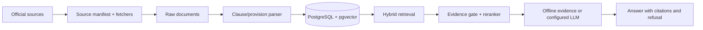

<div align="center">

# AU-WorkLaw-Atlas

<hr>

### Evidence-first Graph-RAG for Australian workplace law.

<p>
  A source-grounded research workspace that turns official workplace-law material
  into a searchable, versioned knowledge base with citations, evidence gates and
  graph navigation.
</p>

<p>
  
  
  
  
</p>

</div>

<hr>

AU-WorkLaw-Atlas turns official workplace-law material into a searchable, versioned knowledge base. It uses PostgreSQL full-text search by default, citation-preserving RAG, and a wiki-style interface for inspecting the provision behind an answer.

## Scope

The project is intentionally staged instead of pretending to cover every Australian employment-law source at once.

| Version | Knowledge added | Main capability |
|---|---|---|
| V1 | Fair Work Act, Fair Work Regulations, current federal instruments | clause-level grounded RAG |
| V2 | Modern Awards, award versions and pay guides | award/condition navigation |
| V3 | Fair Work Ombudsman guides and fact sheets | law-to-guidance evidence chains |
| V4 | Curated Fair Work Commission decisions | interpretation and precedent links |
| V5 | Selected Enterprise Agreements | agreement-vs-award comparison |
| V6 | Cross-source temporal graph and multi-hop retrieval | Graph-RAG research workflow |

## Data policy

The source of truth is the official publisher, not hand-copied text:

- Federal Register of Legislation API and official XHTML/PDF;
- Fair Work Commission document search and published award/agreement documents;
- Fair Work Ombudsman official guides and pay resources.

Raw downloads, parsed chunks, PostgreSQL data, generated wiki pages, and model caches are local artifacts and are intentionally excluded from Git. Each indexed item keeps its publisher, source URL, publication date, effective date, and retrieval timestamp.

## Architecture



The online model is never treated as the source of law. It receives retrieved evidence only. Weak evidence, missing citations, or unsupported conclusions are refused.

## Setup

```bash
python3 -m venv .venv
source .venv/bin/activate
python -m pip install -r requirements.txt

createdb au_worklaw_atlas
psql au_worklaw_atlas < db/schema.sql
cp .env.example .env
```

Set `DATABASE_URL=postgresql://localhost/au_worklaw_atlas` in `.env`. The default path keeps `ENABLE_LOCAL_EMBEDDINGS=false`, so it uses PostgreSQL full-text retrieval without downloading or storing an embedding model.

## Ingestion

For the normal text-only setup, one command runs the full pipeline:

```bash
python3 -m scripts.ingest_all
```

It applies the schema, fetches configured official sources, parses and ingests
Acts/Awards/FWO guidance/FWC decisions/Enterprise Agreements, links references,
materializes the V6 graph and runs integrity checks. It stops immediately if a
stage fails. To reuse already-downloaded source files:

```bash
python3 -m scripts.ingest_all --skip-fetch
```

The default does not download BGE-M3 or write vectors. Only use this optional
profile when the embedding model is installed locally:

```bash
python3 -m scripts.ingest_all --with-embeddings
```

Use `--dry-run` to inspect the stage order without changing files or the
database.

### Individual stages

The individual commands below remain available for debugging or source-specific
refreshes, but are not required for a normal installation.

```bash
# Fetch the configured official source set.
python -m scripts.fetch_worklaw_sources

# Fetch the current Modern Awards and official Pay Guides.
python -m scripts.fetch_awards
python -m scripts.check_awards
python -m scripts.parse_awards

# Parse and ingest text and metadata.
python -m scripts.parse_sections
python -m scripts.embed_and_ingest --skip-embedding
python -m scripts.extract_entities

# Add Fair Work Ombudsman explanations as official guidance.
python -m scripts.fetch_guidance
python -m scripts.check_guidance
python -m scripts.parse_guidance
python -m scripts.embed_and_ingest --skip-embedding

# Add the curated Fair Work Commission decision layer.
python -m scripts.fetch_decisions
python -m scripts.parse_decisions
python -m scripts.embed_and_ingest --skip-embedding
python -m scripts.link_decisions
python -m scripts.check_decisions

# Add the selected Enterprise Agreement layer.
python -m scripts.ingest_agreements
python -m scripts.check_agreements

# Optional upgrade: set ENABLE_LOCAL_EMBEDDINGS=true first, then run this to
# add BGE-M3 vectors. It is not required for the default deployment.
# python -m scripts.embed_and_ingest
```

The fetch step is an explicit data-update operation. Starting the web server does not crawl the internet or rebuild the database.

V2 stores Award clauses as `document_type=award` and Pay Guides as separate
`document_type=pay_guide` records. Pay Guides are official guidance and rate
tables, not substitutes for the legal instrument. The default V2 pipeline is
text-only; set `ENABLE_LOCAL_EMBEDDINGS=true` only when the optional BGE-M3
model is available.

V3 adds FWO Workplace Guides, Fact Sheets and Best Practice Guides as
`document_type=guidance` with `authority_level=official_guidance`. The Ask
response exposes that label so a user can distinguish a legal provision from
an official explanation.

## Evaluation

Run the reproducible retrieval/refusal benchmark and regenerate the Markdown
report:

```bash
python -m scripts.evaluate_rag

# Reproduce the V4 benchmark, including FWC decision questions.
python -m scripts.evaluate_rag \
  --questions config/eval_questions_v4.json \
  --report docs/RAG_EVALUATION_V4.md \
  --json-report output/rag_evaluation_v4.json
```

The default report compares a fair title/body/heading FTS ablation with the
optimized title-aware retriever on the 79-question V5 set using Recall@1/3/5/10,
MRR@10, nDCG@5, evidence-term coverage, stratified Wilson intervals, paired
bootstrap confidence intervals, exact McNemar significance, refusal accuracy
and repeated local latency. It also retains the old body-only baseline as
historical context. It does not label these proxies as RAGAS Faithfulness or
Answer Correctness.

The V4 decision layer is browsable at `/decisions`; each decision page shows
the official source link and its explicit Act, Award and agreement graph edges.
The same decision chunks are eligible for offline evidence answers and online
LLM generation, subject to the existing citation and refusal gate.

V5 agreements are browsable at `/agreements`; each agreement page shows its
industry metadata, official PDF, Award comparison edge and approval decision
when that decision is in the indexed FWC set. Reproduce the V5 benchmark with:

```bash
python -m scripts.evaluate_rag \
  --questions config/eval_questions_v5_large.json \
  --report docs/RAG_EVALUATION_V5_LARGE.md \
  --json-report output/rag_evaluation_v5_large.json
```

The nine-question smoke report remains at `docs/RAG_EVALUATION_V5.md`.

The committed V5 evaluation index is [docs/V5_EVALUATION_INDEX.md](docs/V5_EVALUATION_INDEX.md);
it links to the full Markdown metrics, resume summary, fixed question set and
reproduction command.

## Run

```bash
source .venv/bin/activate
python -m uvicorn frontend.app:app --reload --port 8010
```

Open `http://127.0.0.1:8010`. Ask supports offline evidence mode and online calls through Anthropic, OpenRouter, Gemini, or another OpenAI-compatible endpoint. Browser-entered keys remain session-only; a deployed server should use environment variables instead.

## Repository layout

```text
db/                 PostgreSQL + pgvector schema
scripts/            source fetch, parsing, ingestion and graph extraction
pipeline/           grounded answer pipeline and refusal policy
retrieval/          lexical, dense and hybrid retrieval
frontend/           FastAPI/Jinja/D3 split-pane wiki interface
docs/               roadmap, source notes and screenshots
```

## Safety boundary

This is a research aid, not legal advice. Answers must cite the indexed source and should be checked against the current official publication before a workplace decision.
