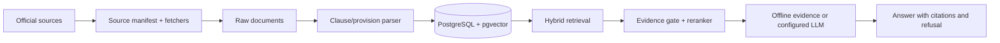

# AU-WorkLaw-Atlas

Evidence-first Graph-RAG for Australian federal workplace law.

AU-WorkLaw-Atlas turns official workplace-law material into a searchable, versioned knowledge base. It uses PostgreSQL full-text search by default, citation-preserving RAG, and a wiki-style interface for inspecting the provision behind an answer.

## Scope

The project is intentionally staged instead of pretending to cover every Australian employment-law source at once.

| Version | Knowledge added | Main capability |
|---|---|---|
| V1 | Fair Work Act, Fair Work Regulations, current federal instruments | clause-level grounded RAG |
| V2 | Modern Awards, award versions and pay guides | award/condition navigation |
| V3 | Fair Work Ombudsman guides and fact sheets | law-to-guidance evidence chains |
| V4 | Curated Fair Work Commission decisions | interpretation and precedent links |
| V5 | Selected Enterprise Agreements | agreement-vs-award comparison |
| V6 | Cross-source temporal graph and multi-hop retrieval | Graph-RAG research workflow |

## Data policy

The source of truth is the official publisher, not hand-copied text:

- Federal Register of Legislation API and official XHTML/PDF;
- Fair Work Commission document search and published award/agreement documents;
- Fair Work Ombudsman official guides and pay resources.

Raw downloads, parsed chunks, PostgreSQL data, generated wiki pages, and model caches are local artifacts and are intentionally excluded from Git. Each indexed item keeps its publisher, source URL, publication date, effective date, and retrieval timestamp.

## Architecture



The online model is never treated as the source of law. It receives retrieved evidence only. Weak evidence, missing citations, or unsupported conclusions are refused.

## Setup

```bash
python3 -m venv .venv
source .venv/bin/activate
python -m pip install -r requirements.txt

createdb au_worklaw_atlas
psql au_worklaw_atlas < db/schema.sql
cp .env.example .env
```

Set `DATABASE_URL=postgresql://localhost/au_worklaw_atlas` in `.env`. The default path keeps `ENABLE_LOCAL_EMBEDDINGS=false`, so it uses PostgreSQL full-text retrieval without downloading or storing an embedding model.

## Ingestion

```bash
# Fetch the configured official source set.
python -m scripts.fetch_worklaw_sources

# Parse and ingest text and metadata.
python -m scripts.parse_sections
python -m scripts.embed_and_ingest --skip-embedding
python -m scripts.extract_entities

# Optional upgrade: set ENABLE_LOCAL_EMBEDDINGS=true first, then run this to
# add BGE-M3 vectors. It is not required for the default deployment.
# python -m scripts.embed_and_ingest
```

The fetch step is an explicit data-update operation. Starting the web server does not crawl the internet or rebuild the database.

## Run

```bash
source .venv/bin/activate
python -m uvicorn frontend.app:app --reload --port 8010
```

Open `http://127.0.0.1:8010`. Ask supports offline evidence mode and online calls through Anthropic, OpenRouter, Gemini, or another OpenAI-compatible endpoint. Browser-entered keys remain session-only; a deployed server should use environment variables instead.

## Repository layout

```text
db/                 PostgreSQL + pgvector schema
scripts/            source fetch, parsing, ingestion and graph extraction
pipeline/           grounded answer pipeline and refusal policy
retrieval/          lexical, dense and hybrid retrieval
frontend/           FastAPI/Jinja/D3 split-pane wiki interface
docs/               roadmap, source notes and screenshots
```

## Safety boundary

This is a research aid, not legal advice. Answers must cite the indexed source and should be checked against the current official publication before a workplace decision.
